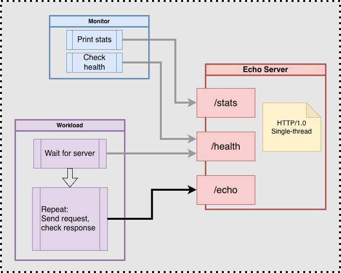
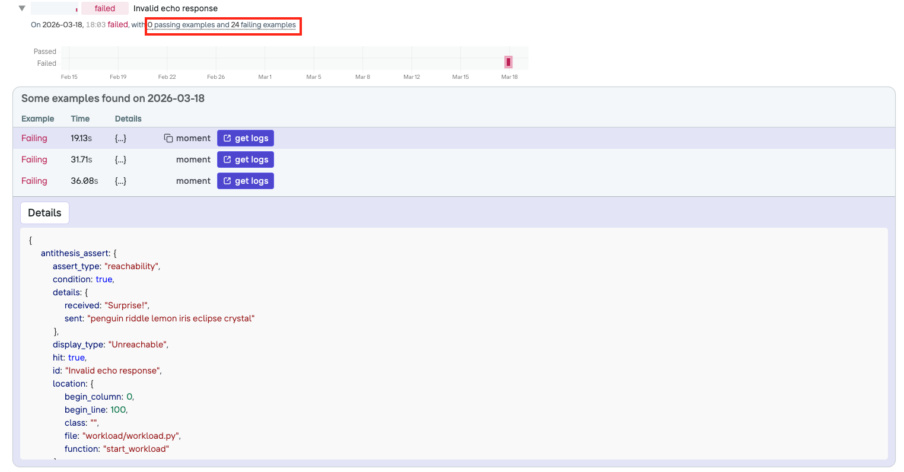
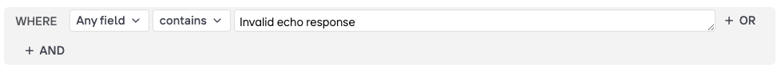
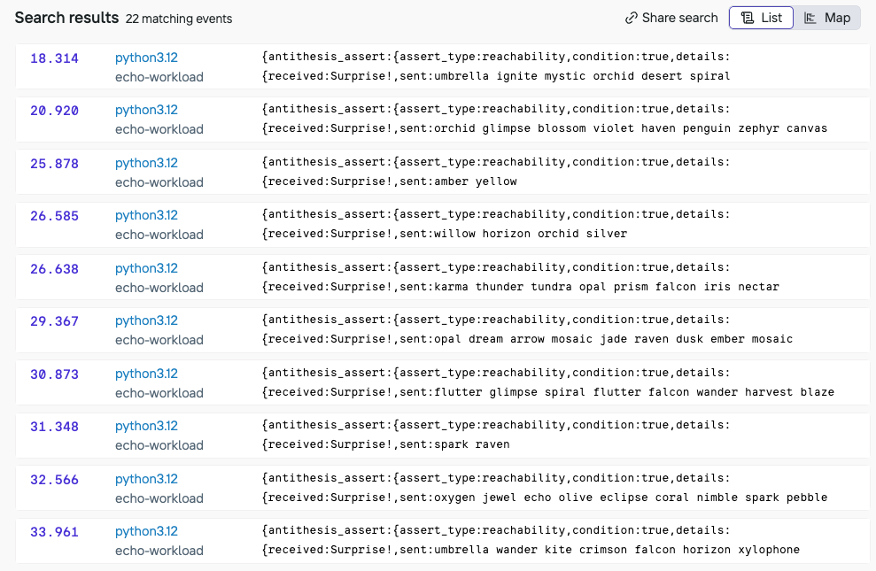
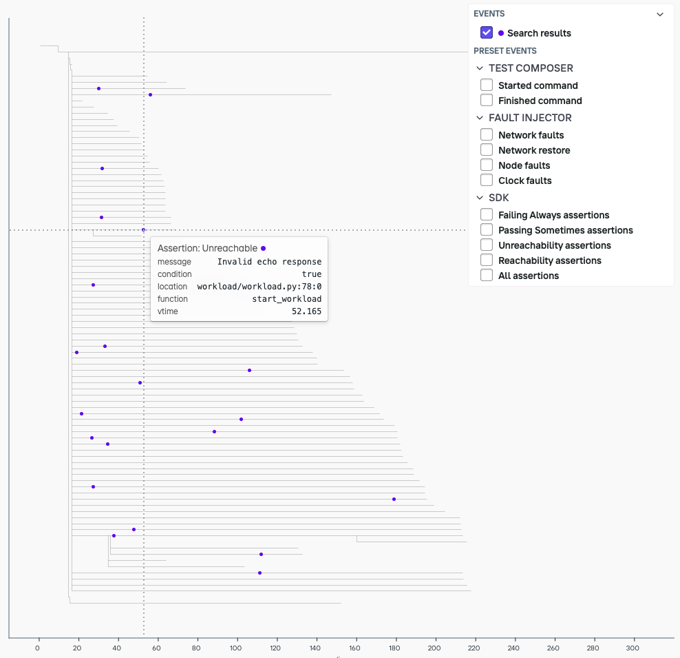
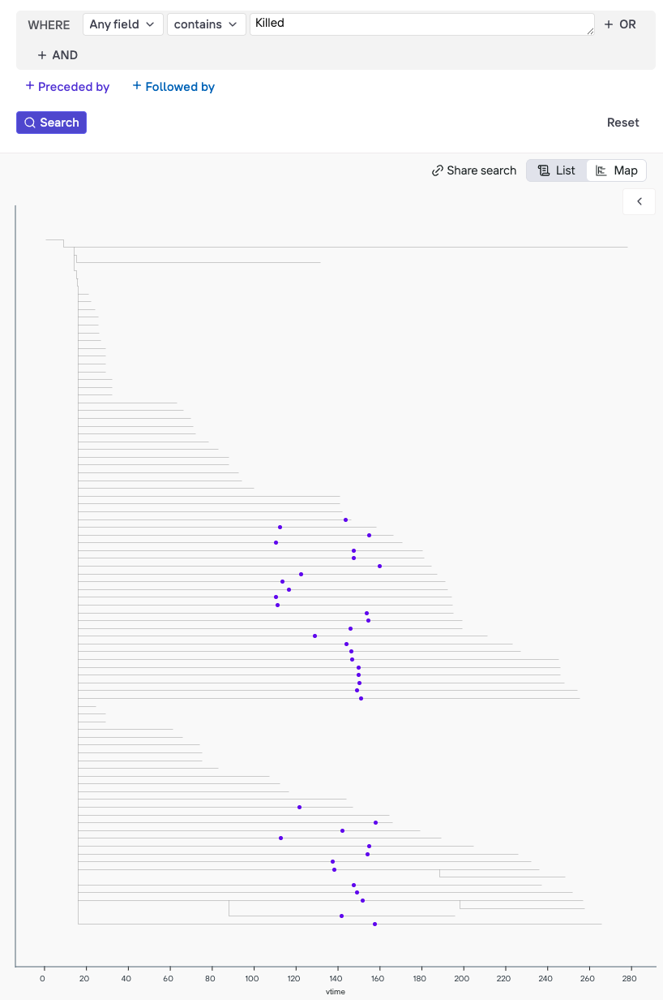
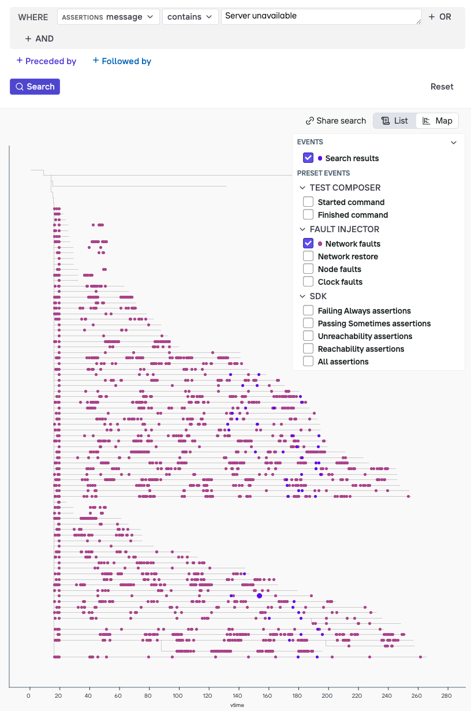

## Antithesis Hands-on Tutorial: First Bug Hunt!

This tutorial will guide you through your first mission to find and neutralize bugs with Antithesis.

This project contains a simple system, fully set up for Antithesis.
You will:
 - Run the tests, then run the system locally with a workload
 - Launch an Antithesis exploration campaign to search for system misbehavior
 - Investigate bugs using the experiment report
 - Fix the bugs
 - Launch another Antithesis experiment to verify the bugs have been neutralized.

Happy bug hunting!

---

## Requirements

This tutorial requires:
 - **Python (3.9+)** if you want to run tests locally
 - **Docker** or **Podman** if you want to run the entire system locally (update `Makefile` if using Podman)

Although the code is simple enough that you can understand what it does without actually running it, so these requirements are optional.

#### Environment setup

The python project has a few dependencies (such as the `requests` library).
Run `make venv_setup` and follow the instruction to create and activate a local virtual environment. Run `make venv_check` to verify it.

You can sanity-check your Docker (or Podman) setup with `make check`.

---

## Meet the SUT

SUT stands for 'System Under Test'; it is whatever you are putting under the microscope in Antithesis.

In this case, the SUT consists of a Python HTTP server that implements an "echo" service.
That is, an endpoint that responds to POST requests by sending back exactly the same bytes as the request body.

```
  # Respond to echo requests by sending back the request body verbatim
  on_echo_request(request) {
    request.send_response(200, request.body)
  }
```

The service exposes two additional endpoints: `/health` (which returns 200/OK), and `/stats` (which exposes server runtime counters).

A client for this server is also provided; it is part of the SUT and will be put under test.



**Somewhere inside the client and server, there are two bugs**: one obvious, one lurking in the shadows.

### Bug #1: Wrong response

This bug is trivial, but it is planted as a placeholder for the insidious "one in a million" bugs that are very hard to discover, as they require some specific set of rare circumstances to manifest.

```
on_echo_request(request) {
  if random(1_000_000) == 0:
    # One-in-a-million chance to send the wrong response
    request.send_response(200, "Surprise!")
  else:
    request.send_response(200, request.body)
}
```

As we will see, standard testing overlooks this bug!

### Bug #2: ???

The second bug is hidden, as all good bugs are.

We encourage you not to go look for it just yet. Instead, try to find it by investigating the symptoms, as you would for a real bug.

# Part 1 - Local tests

From the `python` directory, run `make test` to run all the tests for the `client` and `server` modules, plus an additional end-to-end test that uses the client to make 100 requests to the server.

These tests have a chance to uncover the planted bugs — especially Bug #1 — but they very likely will not!

In fact, we encourage you to run the e2e test in a loop, and see how long it takes to discover Bug #1:
```sh
time while make test-e2e; do echo PASS; done
```

Warning, it may take **hours** before bug #1 surfaces and makes the command above fail -- don't wait up!

---

# Part 2 - Workload

In order to test our client & server in Antithesis, all we need to do is:
 - Put them to work
 - Check that they are working correctly

For this, we use a **workload**. A workload is one or more pieces of code that:
 - Continuously exercises the system under test (client+server in this case)
 - As it runs, checks that good things happen and bad things don't happen (i.e. our liveness and safety properties)

In this case, the workload consists of an infinite loop sending requests and checking for valid responses.

```
while True:
  req = create_random_request()
  resp = client.echo(req)
  if req != resp
    antithesis.alert("Response mismatch!" details: {req, resp})
```

The primary correctness (safety) property that this validates is that using the echo service via the client always produces a valid response (if the request succeeds).

The workload does a few more things than the stylized version above:

### Fault tolerance

In Antithesis, we are going to test in the presence of faults.
Some number of requests may fail, and that's ok.
Errors are counted and printed, but the workload keeps running.

```
  try:
    resp = client.echo(req)
  catch Exception e:
    errors++
```

### Progress check (liveness)
Temporary service outages are ok, but we never want our server to become permanently unavailable, i.e. stop responding to *all* future requests.
For this reason, we keep track of the last successful request, and raise a flag if it's been too long since the last successful operation.

```
  if now() - last_successful_request > alert_threshold:
    antithesis.alert("Server unavailable for over {alert_threshold} seconds")
```

### Progress statistics
Every few seconds, the workload prints the count of successful requests and errors. This is useful to keep track of what is happening without flooding the output with each and every request and response.

## Run the system locally

To launch a local version of the Antithesis experiment, consisting of the workload running against the server, execute: `make run`.

This will:
 - Build a Docker image (containing both server and workload)
 - Bring up a Docker Compose environment
 - The workload will keep running until stopped

The setup is declared in `python/antithesis/config/docker-compose.yml`, take a quick look.

The most important services are `workload` and `server`.
Ignore the additional services for now. We'll come back to them later.

Notice how each service references an entry-point script like `start_server.sh` and `start_workload.sh`.
You can find those in `python/antithesis/`, feel free to take a look.

The output may look something like this:

```
echo-server     | Starting server at 0.0.0.0:4444
echo-monitor    | Starting monitor targeting echo-server:4444
echo-workload   | Starting workload targeting echo-server:4444
echo-server     | Echo server listening on http://0.0.0.0:4444
echo-workload   | Workload running against http://echo-server:4444
echo-monitor    | echo-server:4444 : up=3.1s requests=10200 (+0) responses=10200 (+0) total_data=605.9KiB (+0.0B)
echo-workload   | Success: 17754 Errors: 0 Invalid response: 0
echo-monitor    | echo-server:4444 : up=6.2s requests=21774 (+11574) responses=21774 (+11574) total_data=1.3MiB (+684.8KiB)
echo-monitor    | echo-server:4444 : up=9.2s requests=32532 (+10758) responses=32532 (+10758) total_data=1.9MiB (+639.4KiB)
echo-workload   | Success: 36111 Errors: 0 Invalid response: 0
echo-monitor    | echo-server:4444 : up=12.2s requests=43543 (+11011) responses=43543 (+11011) total_data=2.5MiB (+651.3KiB)
echo-workload   | Success: 53207 Errors: 0 Invalid response: 0
[...]
```

The `monitor` service polls the server's `/stats` endpoint and prints server metrics at regular intervals.

A very large number of requests will be served.
The network is local and the service is fast.
You may even spot the occasional error due to Bug #1 if you leave this running long enough.

Now let's run the same system in Antithesis.

---

# Part 3 - First experiment

Navigate to the GitHub repository `Actions` and select the `Antithesis - Python Echo Server` workflow.

Manually start an experiment by filling in the fields, and hitting Run.


Assuming you set a duration of 30 minutes, you'll get a report in your inbox in about 35 minutes.

Let's use this time to look at a few things.

[Don't want to wait? Here's a sample report](https://honey-whale.antithesis.com/report/SF1tDgoGevsVOmDIGi3Kgtx_/qbpldAmsyfXsFkjzYkb8Xj7exuHpNNVVX8L4BFuP9zI.html?auth=v2.public.eyJuYmYiOiIyMDI2LTAzLTI1VDAzOjUxOjAyLjM3MzA1NDgxNloiLCJzY29wZSI6eyJSZXBvcnRTY29wZVYxIjp7ImFzc2V0IjoicWJwbGRBbXN5ZlhzRmtqellrYjhYajdleHVIcE5OVlZYOEw0QkZ1UDl6SS5odG1sIiwicmVwb3J0X2lkIjoiU0YxdERnb0dldnNWT21ESUdpM0tndHhfIn19fb9NVVjyeiWsUm24SXBn6qdSOMKE9RWSdyb5Ikv20cE0RxxA6m3bM3DkMqlh9ruXK6J-FsYoAuSigj7Bmos4FQ8)

---

# Intermezzo - Project structure, important files and concepts


### Build images and launch experiment

Let's look at the GitHub workflow that you just used to launch an experiment: `.github/workflows/python_antithesis_experiment.yml`

The important steps are:

1. Build and publish a `config` image. This image tells Antithesis how to run your software. Its most important file is `docker-compose.yml`. The Dockerfile for this image is located in `python/antithesis/Dockerfile`. It consists of an empty image where we copy `docker-compose.yml` along with an `environment` file.

2. Build and publish a `sut` image ("System Under Test"). This image is based on Ubuntu and includes all the files to run the server, workload, and the other services listed in the docker-compose file.
The Dockerfile for this image is in `python/Dockerfile`.

3. After images are built and published, we tell Antithesis to launch a new experiment by hitting a specific web endpoint. The request body will look something like this:
```
{
  "params": {
    "antithesis.duration": "30",
    "antithesis.config_image": "python-echo-server-config:16_abfa9df464812b180a4c2f7d48026fe6b28d7c6a",
    "antithesis.description": "My first experiment",
    "antithesis.report.recipients": "my.name@example.com"
  }
}
```

Notice how it references the `config` image we just published, as well as specifying duration and notification address.

The script that makes this request can be found in `python/antithesis/scripts/launch_experiment.sh`

### SUT image
See: `python/Dockerfile`

In this case we are building a single image that contains `server`, `workload`, `monitor` and more. But as you can see from `docker-compose.yml` each service uses a different entry-point to play a different role.

### `python/antithesis/config/docker-compose.yml`

For the most part, this is a regular docker-compose file. 
However, notice the definition of a special `antithesis-net` network. And a corresponding explicit IP address assignment for each service that uses the network.

This is required for Antithesis to intercept network traffic, and mess with it.

## Additional containers

There are two more services defined in `docker-compose.yml` that we have not addressed yet.

### Service: `pause-faults`

Antithesis introduces all sorts of mayhem into the environment in order to push the system to hard-to-reach states and find interesting bugs.

With default settings, the faults are *unbound*, i.e. the fault injector can do anything it pleases.

In order to test for liveness and recovery, we want faults to be *bound* (i.e. limited to some specific intervals).
This container runs a script that turns the fault injector on and off at regular (random) intervals.

The simplified logic is:
```
while true:
  # Faults ON for $random_on seconds
  random_on = random(MIN_ON, MAX_ON)
  sleep(random_on)

  # Faults OFF for $random_off seconds
  random_off = random(MIN_OFF, MAX_OFF)
  pause_faults(random_off)
  sleep(random_off)
```

### Service: `monitor`

This service polls and prints server statistics (`/stats` server endpoint).

It is often a good idea to observe the system and the workload from an outside perspective, to make sure they are not stuck and to report high-level progress without excessive logging.

---

# Part 4 - First report

So you received your first report!

Let's look at the main sections.

### Environment
These are the images used.

### Utilization

Notice that we just ran **24 hours** of testing in just **30 minutes**!

For supported languages, this would show a graph of "new behaviors" discovered. A metric akin to coverage, but applied to the entire system state-space.

In this case, there is no graph because Python is currently not supported.

### Findings

Findings allow you to compare today's bugs to yesterday's.

Since this is your first experiment, this is not very useful.
Ignore this for now.

### Properties

Feel free to explore the passing properties.

When you're ready to hunt for bugs, switch the filter to `Failed` and expand all properties that require attention.

#### `Symbols were uploaded`
This is expected, as Python is not fully supported.

#### `Software was instrumented`
This is expected, as Python is not fully supported.

#### `Thread pausing was enabled`

This is expected, as Python is not fully supported.

#### Invalid echo response

Let's start from known Bug #1. This property is telling us that the workload is sometimes receiving an invalid response.

The property we are checking is: **the echo endpoint always sends back the request body when responding successfully**.

In the workload we encode this property as an `unreachable`:

```python
# Request was successful
[...]
# Check response
if response == message:
    [...]
else:
    print(f"Invalid response! Sent '{message!r}', Received '{response!r}'")
    [...]
    details = {
        "sent": message,
        "received": response,
    }
    unreachable("Invalid echo response", details)
```

Antithesis gives us a few examples of this property failing, along with the `details` for each.

For each example, we can also see the logs leading up to that particular moment.

Expand one of the examples:

```
(Assertion: Unreachable)
message: "Invalid echo response",
  file: workload/workload.py,
  line: 64,
  function: start_workload
  details: {
    sent: ivory violet kite iris spark
    received: Surprise!,
  }
```

In this case, it's clear what is happening: **Antithesis found our "one in a million bug" a couple dozen times within 30 minutes!** That's because it squeezed 24 hours of testing time into a half-hour.



#### `Unexpected server restart`

In this setup, we expect the server to keep running in perpetuity.

To detect an unexpected server crash-restart, the `monitor` service keeps tabs on the server uptime returned by the `/stats` endpoint. If the latter gets reset, the monitor flags this as an unexpected event.

The property we are implicitly checking is: **Server uptime grows monotonically**. We encode this property as an `unreachable` assertion in the monitor:

```python
if self.current_stats['uptime_seconds'] < self.previous_stats['uptime_seconds']:
    [...]
    details = {
        "previous_uptime": self.previous_stats['uptime_seconds'],
        "current_uptime": self.current_stats['uptime_seconds'],
    }
    unreachable("Unexpected server restart", details)
```

Server restarts are unexpected, so let's take a look at the logs for one of the examples by clicking the 'Get logs' button.

This opens the logs for a timeline leading up to that property being violated.

To reduce noise, let's filter out everything except for the server logs.

> ▽ (filter) > Container > `echo-server` > Only

It may show something like this:

```
13.821 Loading virtual environment...
13.822 Starting server
13.822 Bind address: 0.0.0.0:4444
13.875 Echo server listening on http://0.0.0.0:4444
112.033 Server exited with code 137
112.033 /app/start_server.sh: line 31:  23 Killed  python3 -u -m src.server --host ${BIND_ADDRESS} --port ${BIND_PORT_NUMBER} ${VERBOSE}
112.103 Loading virtual environment...
112.103 Starting server
112.103 Bind address: 0.0.0.0:4444
112.114 Echo server listening on http://0.0.0.0:4444
```

About 2 minutes into this timeline, the server gets killed by a `SIGKILL`. Interesting!

The good news is that it restarts almost immediately without issues.

Let's move on to the other properties for now, we'll come back to investigate this later.

#### `Server unavailable for too long (workload requests)`
This is telling us that the `workload` is unable to get a response from the server for a consecutive period of time (the threshold for this alert is set in `docker-compose.yml`: `ALERT_INTERVAL=20`).

Click on the logs for one of the examples and filter to just `workload`:

> ▽ (filter) > Source > `echo-workload` > Only

You may see something like this:

```
[...]
74.430 Success: 164793 Errors: 0 Invalid response: 1
79.430 Success: 178711 Errors: 2 Invalid response: 1
84.430 Success: 178711 Errors: 7 Invalid response: 1
89.430 Success: 178711 Errors: 9 Invalid response: 1
93.430 Success: 178711 Errors: 14 Invalid response: 1
97.430 Success: 178711 Errors: 19 Invalid response: 1
98.068 WARNING: 20.0s since the last successful request
```

Notice the number of successful requests is flat, while errors are going up at about 1 per second.

The server does indeed seem to be unreachable or unresponsive for an extended period of time!

This seems like a legitimate problem.
We'll come back to it later.

#### `Server unavailable for too long (monitor health-check)`
This is telling us that the `monitor` is unable to get a successful health-check response for a consecutive period of time (the threshold for this alert is set in `docker-compose.yml`: `HEALTH_ALERT_INTERVAL=20`).

Click on the logs for one of the examples and filter to `monitor`:

> ▽ (filter) > Source > `echo-monitor` > Only

You may see something like this:

```
[...]
20.653 Health check failed: timed out
25.654 Health check failed: timed out
30.682 Health check failed: timed out
39.982 Health check failed: timed out
39.982 WARNING: 20.7s since last successful health-check
```

Another confirmed issue.

---

# Part 5 -- Diagnose and fix the bugs

So far we have confirmed that the property failures in the report are genuine problems by looking at the logs for some of the examples.

Now let's investigate, find the bugs and fix them!

This may be a good time to create a separate branch to commit your changes.

`git checkout -b bug-fixes`

Once you're ready, hit the `Get more logs` button at the top of the report. This will take you to the **Logs Explorer**.

The Logs explorer allows us to search for log messages and events (like property failures) across all the branches of the "multiverse" explored by Antithesis in this experiment.

## Bug #1 - Invalid response

This bug is planted intentionally, and we understand how it manifests.

Run the following search:

 > `Any fields` > `contains` > `Invalid response`



⚠️ **Note:** Hitting Enter seems to clear the search field — in reality it adds a newline. Use Ctrl+Enter to search instead, or click the search button.

A list of examples will start rolling in.

Remember how multiple hours of local testing could not find Bug #1?

In 30 minutes, Antithesis found this bug dozens of times!
That's because the system was under test for the equivalent of 24 hours, compressed into 30 minutes.



Now switch to `map` view to see the search results plotted over different timelines.



Click on any of the blue dots to load the logs for that timeline up to that moment.

This bug is pretty cheeky.
To fix it, delete the 4 lines of code that introduce it (in the `process_echo_request` function in `server.py`).

```diff
def process_echo_request(self, request_body):
-    # Artificial "One in a million" bug. {*}
-    with open("/dev/urandom", "rb") as f:
-        r = int.from_bytes(f.read(4), "big")
-        if r % 1_000_000 == 0:
-            return "Surprise!".encode('utf-8')

```

## Bug #2 - Server unresponsive and restarting

Let's see what we know so far:

- The server sometimes unexpectedly restarts
- The server is unable to respond to requests and health checks for extended periods of time

A couple of things to keep in mind:

- The server is single-threaded. So we can rule out any concurrency bugs
- By default, Antithesis will not kill our containers, that needs to be enabled, but it's off in this case
- Antithesis is introducing network faults but we limit the maximum duration of these via `pause-faults`
- The server is (mostly) stateless. The only state is a list of the last N requests received, kept around for debugging in case of an unhandled exception.

With that in mind, let's explore logs to see if we can spot some patterns that can lead us to the bug.

#### Q: Is there a pattern in the crashes?

Run the following search in the Logs Explorer:

 > `Any fields` > `contains` > `Killed`



Interestingly, restarts are not uniformly distributed over time. They tend to cluster between t=100 and t=160. This seems like a clue.

#### Q: Is there a pattern in the unavailability periods?

Run the following search in the Logs Explorer:

 > `Assertion: message` > `contains` > `Server unavailable`

Let's also turn on the `Network faults` display overlay.



Another interesting (non-uniform) distribution: unavailability periods do not seem to overlap with network fault periods.

This is what we expected since we configured faults to last between 5 and 15 seconds, and the unavailability alert triggers after 20 seconds.

Unavailability is clustered between t=120 and t=200, slightly after the restarts. This seems like a clue.

Click on one of the blue dots to see the corresponding logs. It may look something like this:

```
109.656 echo-server /app/start_server.sh: line 31:    23 Killed                  python3 -u -m src.server --host ${BIND_ADDRESS} --port ${BIND_PORT_NUMBER} ${VERBOSE}
109.656 echo-server Server exited with code 137
109.725 echo-server Starting server
109.736 echo-server Echo server listening on http://0.0.0.0:4444
110.004 echo-workload Success: 320137 Errors: 1 Invalid response: 0
115.004 echo-workload Success: 320137 Errors: 1 Invalid response: 0
116.864 pause-faults Faults OFF for 26s
120.004 echo-workload Success: 320137 Errors: 1 Invalid response: 0
125.004 echo-workload Success: 320137 Errors: 1 Invalid response: 0
130.004 echo-workload Success: 320137 Errors: 1 Invalid response: 0
130.676 echo-workload Request failed: HTTPConnectionPool(host='echo-server', port=4444): Max retries exceeded with url: /echo (Caused by NameResolutionError("HTTPConnection(host='echo-server', port=4444): Failed to resolve 'echo-server' ([Errno -3] Temporary failure in name resolution)"))
131.676 echo-workload WARNING: 22.0s since the last successful request
```

- `t=109` Server restarts
- `t=110...130` The workload is 'stuck' on a single request (notice the number of errors is not going up)
- `t=131` we learn that the workload was stuck trying to resolve DNS!

The workload eventually manages to resolve and resume requests.

But at least we know how these unavailability properties are triggering: it may take over 20 seconds for Python to re-resolve DNS after a container restart.

We learned something interesting about our system, but fixing this is out of scope for this tutorial.

Let's focus on figuring out why the server is crashing in the first place.

#### Hypothesis: Memory leak / OOM

An exit code of 137 indicates the server was killed with a SIGKILL. One common reason for this to happen is that the process is out of memory!

We said earlier the server is *mostly* stateless. The only state it retains is a list of the last 15 requests received (`EchoHandler::MAX_RECENT_REQUESTS`).

We append to this list in `save_request` and then trim it — or do we?

```
    def save_request(request_body):
        # Save the last request, useful for debugging in case of crash
        EchoHandler.RECENT_REQUESTS.append(request_body)
        # Only retain the most recent MAX_RECENT_REQUESTS requests
        if len(EchoHandler.RECENT_REQUESTS) > EchoHandler.MAX_RECENT_REQUESTS:
            EchoHandler.RECENT_REQUESTS[-EchoHandler.MAX_RECENT_REQUESTS:] # {*}

```

D'oh! We are taking a slice, but not re-assigning it. The `RECENT_REQUESTS` list will grow without bound until the server is OOM-killed.

Let's fix this by assigning the slice:

```diff
-            EchoHandler.RECENT_REQUESTS[-EchoHandler.MAX_RECENT_REQUESTS:]
+            EchoHandler.RECENT_REQUESTS = EchoHandler.RECENT_REQUESTS[-EchoHandler.MAX_RECENT_REQUESTS:]
```

---

# Part 6 - Run again

Verify everything still works as expected by running `make run`.

Commit the changes to your branch, push it, and trigger another build.

Make sure it's using your branch and not `main`!


The report is green! (except for Python coverage properties, which we can ignore).

[Don't want to wait? Here's a sample report](https://honey-whale.antithesis.com/report/SC23ZBV0NiKBg0hu_gLR46uu/jlkLzCh_Nvn9AMK_ZIAJLZBdCaaw4VQaXzzblqNvxfs.html?auth=v2.public.eyJuYmYiOiIyMDI2LTAzLTI1VDAzOjQ4OjU2Ljk1MTI5MzY2NFoiLCJzY29wZSI6eyJSZXBvcnRTY29wZVYxIjp7ImFzc2V0IjoiamxrTHpDaF9Odm45QU1LX1pJQUpMWkJkQ2FhdzRWUWFYenpibHFOdnhmcy5odG1sIiwicmVwb3J0X2lkIjoiU0MyM1pCVjBOaUtCZzBodV9nTFI0NnV1In19fWub4LPqzcrKVW1LCVzDC801AoyRqKW8CM3t69CKMI0cYRZUKpGwVZKDRcOAhgec9B6O_JY2U7kqj7e9d4Fphw0)

# Conclusion

Congratulations on finding and fixing your first bugs with Antithesis.
